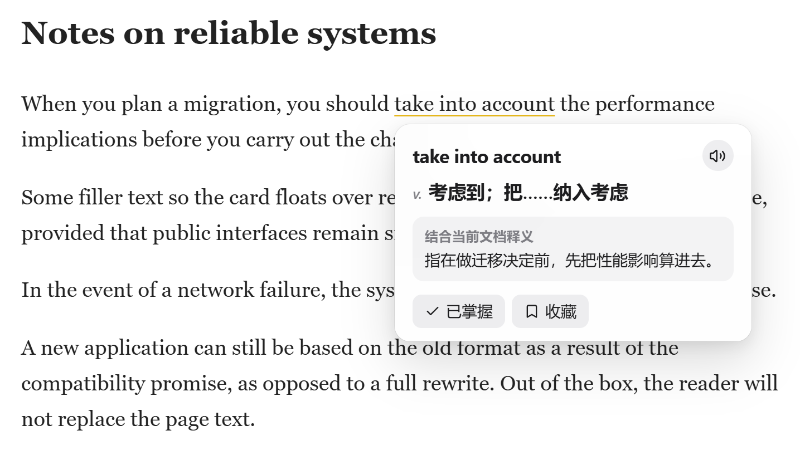
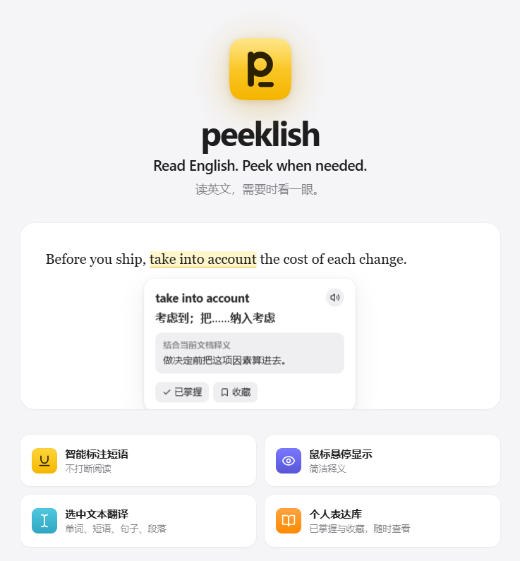
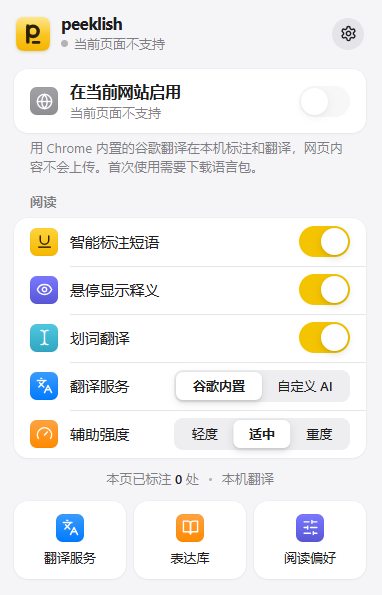
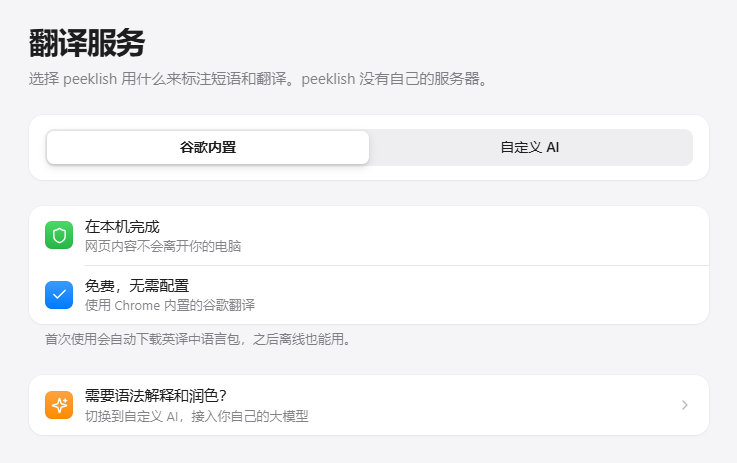

<p align="center">
  
</p>

<h1 align="center">peeklish</h1>

<p align="center">
  Read English. Peek when needed.<br>
  读英文，需要时看一眼。
</p>

<p align="center">
  <a href="LICENSE"></a>
  
</p>

<p align="center">
  阅读英文网页时，只在值得学的短语下加一条淡下划线。鼠标悬停才显示中文。
</p>

<p align="center">
  
</p>

peeklish 是一个 Chrome 扩展。选中单词、短语、句子或段落时，再翻译。默认使用 Chrome 内置的谷歌翻译，在本机完成；也可以接入你自己的 OpenAI Chat Completions 兼容接口。扩展没有服务器。

## 功能

- 只标注值得复用的英文短语，不把整页铺满高亮。
- 悬停显示结合当前句子的简体中文释义，可以朗读、标记「已掌握」或收藏。
- 划词翻译单词、短语、句子和段落。
- 辅助强度分轻度、适中、重度，控制每段标注密度。
- 表达库保存在本机，可搜索已掌握和收藏的表达。
- 默认「谷歌内置」：Chrome 自带翻译模型，在本机完成，不需要 API Key。
- 「自定义 AI」可接入兼容 OpenAI Chat Completions 的接口，并提供语法解释和润色。
- 默认不读取任何网站。只有你在弹窗里启用的来源才会注入阅读脚本。

<p align="center">
  
</p>

## 安装

需要较新的桌面版 Chrome，并且支持内置 Translator API。不支持的版本仍可改用自定义 AI。

1. 打开 [Releases](https://github.com/change-everything/peeklish/releases)，下载 `peeklish-1.0.0-chrome.zip`。
2. 解压。
3. 打开 `chrome://extensions`，打开右上角「开发者模式」。
4. 选择「加载已解压的扩展程序」，选中解压后的目录。

首次安装会打开欢迎页。无痕窗口不启用本扩展。

## 启用一个网站

默认不读取任何网站。在网页里点工具栏图标，打开「在当前网站启用」。浏览器会询问这个网站的访问权限。之后只有这个来源会注入阅读脚本。

<p align="center">
  
</p>

暂停会立刻去掉本页标注，配置和表达库还在。在 `chrome://`、扩展商店和扩展自己的页面上会显示「当前页面不支持」。

本地试用可以打开 `demo/article.html`。需要用本地 HTTP 服务打开，例如：

```bash
npx serve demo
```

然后在 `http://127.0.0.1` 上启用该站点。自定义 AI 的接口地址仍然必须是 HTTPS。

## 翻译服务

默认是「谷歌内置」：Chrome 自带的翻译模型，在本机完成，不需要任何配置，第一次使用会下载语言包。这台 Chrome 不支持时，弹窗会提示升级或改用自定义 AI。选择「谷歌内置」时，设置页不显示大模型配置，卡片里也不显示「语法」和「润色」。

<p align="center">
  
</p>

需要语法解释和润色时，改用「自定义 AI」：

1. 点击工具栏图标，打开「翻译服务」，选择「自定义 AI」。
2. 填写 HTTPS 的接口地址、API Key 和模型。地址不能带账号密码或 hash。
3. 保存时会请求该接口域名的访问权限。
4. 点「测试连接」。成功只说明接口有响应，不保证每个模型都稳定返回 JSON。
5. 已启用网站上的英文片段会发给这个接口。

Key 默认只保存在本次浏览器会话，关闭浏览器后失效。如果选择「保存在本机」，扩展会提示 Key 未加密（`chrome.storage.local` 不是加密保险库）。

旧版本里没有填写接口地址的用户，升级后会自动切换到「谷歌内置」。

## 权限

- `storage`：保存设置、站点开关和 Key。
- `scripting`：只向你启用的网站注入脚本。
- `activeTab`：你点图标时访问当前标签页。
- `offscreen`：在离屏文档里运行 Chrome 内置翻译。
- 可选主机权限：启用某个网站，或保存 API 地址时，才申请对应来源。安装时不会拿到所有网站的访问权。

不申请历史记录、Cookie、`webRequest` 或全部标签页权限。

## 隐私边界

- 「谷歌内置」在本机翻译，不会把网页文本发出去。
- 「自定义 AI」只会把已启用、并且你同意过的网站上必要的段落或选区，发给你填写的接口。
- 悬停使用分析时缓存的释义，不会为同一次标注再请求一次。
- API Key 只留在扩展的 service worker 和设置页，不进入内容脚本、网页 DOM、请求日志或表达库。
- 网页里的文字一律当数据，不会当成给模型的系统指令。模型返回的内容只按纯文本显示。
- 无痕窗口不启用本扩展。

## 从源码构建

需要 Node.js 20 或更新版本。

```bash
npm install
npm run icons
npm run dev
```

如果官方源因为证书校验失败，可以改用镜像：

```bash
npm install --registry https://registry.npmmirror.com
```

`npm run dev` 会打开 Chrome 的扩展开发目录。在 `chrome://extensions` 打开开发者模式，加载该目录。

构建解压目录：

```bash
npm run build
```

产物在 `.output/chrome-mv3`。到 `chrome://extensions`，打开开发者模式，选择「加载已解压的扩展程序」，选中这个目录。

打包成 Release 用的 zip：

```bash
npm run zip
```

产物在 `.output/`，文件名类似 `peeklish-1.0.0-chrome.zip`。

## 测试

```bash
npm test
```

测试覆盖短语定位、密度和「认识」过滤、API 地址校验、JSON 解析、内置短语词库，以及 jsdom 里的段落提取和页面标注。没有填写真实 Key 时，测试不会访问网络。

构建之后也可以在本机 Chrome 里点开欢迎页、设置页和 Popup：

```bash
node scripts/smoke-ui.mjs
```

## 目录

| 路径 | 内容 |
| --- | --- |
| `src/entrypoints` | 弹窗、设置页、后台和内容脚本入口 |
| `src/content` | 页面标注、悬停卡片、划词 |
| `src/domain` | 短语选择、提示词、模型输出校验 |
| `src/background` | 消息处理、内置翻译、站点脚本注册 |
| `src/storage` | 设置、Key、表达库和缓存 |
| `demo` | 本地试用文章 |
| `tests` | 单元测试和 DOM 测试 |

## 许可证

[MIT](LICENSE)
